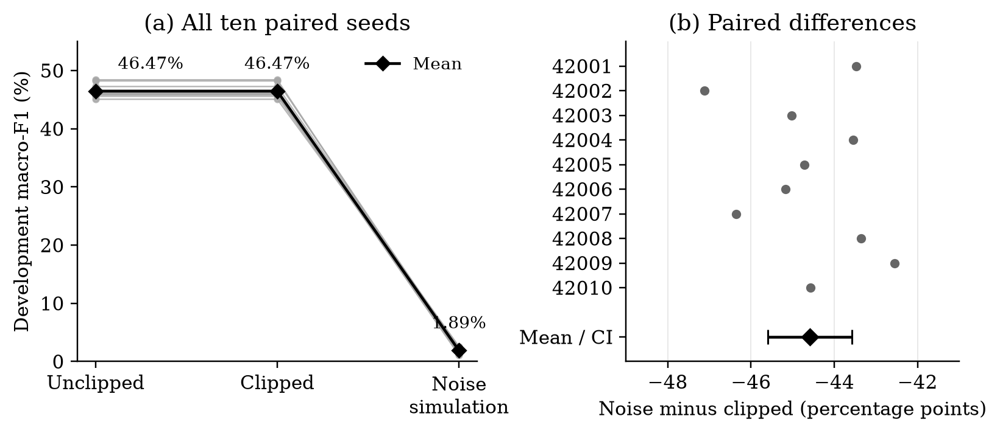

## Appendix B. Motion-data development study

Ning Yang

**Purpose and provenance.** This exploratory study checks MM-Fi radar activity recognition before testing a new local-learning SNN. It is separate from the frozen CSDP study in Appendix A. An earlier adapter clipped the entire fourth binary column and concatenated frames across missing indices. Those failed results are retained; the revised protocol and training-code hashes were recorded before fitting. The revised task predicts one label per recording, so its scores cannot isolate the adapter's effect relative to the earlier window task.

**Data and representation.** The official filtered archive [24] supplied 646 recordings from 24 training subjects and 215 from eight development subjects, covering 27 classes; eight test subjects' sensor payloads remain unopened. Three expected recordings are absent. Columns remain anonymous because serialized field order and units are unverified. A fixed monotone transform, $2\arctan(v)/\pi$, precedes frame statistics. Slots 1–297 and availability masks preserve gaps; ten-slot blocks yield 30 steps, with seven slots in the last block. The source already includes filtering and aggregation; this is an offline benchmark without a zero-look-ahead claim.

**Non-private references.** Table B1 checks whether the development task contains learnable signal. Evaluation normalises each subject's confusion weight and averages F1 across all 27 classes. Model families have different budgets: this is not an algorithm-superiority comparison. Logistic repeats are deterministic, not independent seeds. GRU endpoints are fixed at epoch 40, not selected by development performance.

**Table B1. Non-private development references.** Ranges describe seeds, not confidence intervals.

| Reference | Macro-F1 | Seed range | Repeats and fixed budget |
|:---|---:|:---|:---|
| Fixed-feature logistic | 54.08% | deterministic | 3 identical fits; max_iter 2000 |
| ExtraTrees | 69.28% | 68.85–69.71% | 3 seeds; 250 trees |
| GRU | 56.80% | 53.81–61.33% | 3 seeds; 48 units; 40 epochs |
| Mask-only logistic | 4.04% | deterministic | 3 identical fits; max_iter 2000 |

The mask-only control uses availability rather than radar values. ExtraTrees reaches 100% training macro-F1, so its development score should be read alongside the risk of overfitting. These references establish learnability in this cohort; they do not validate a new learning method.

\newpage

### Fixed-head noise utility check

A fixed, unfitted 108-dimensional representation feeds a softmax head; the trained GRU is never used as a private encoder. Ten paired seeds share initialisation and subject masks. At each of 300 rounds, equal-record averages within each person are jointly clipped at norm 1. Poisson sampling at $q=1/3$, Gaussian multiplier 8.738442 and fixed denominator eight give a single-mechanism RDP bound $\varepsilon\leq3$, $\delta=10^{-5}$ under add/remove-one-subject adjacency. Empty batches still receive noise.

{width=100%}

**Figure B1.** All ten paired seeds. Panel (a): development macro-F1; unclipped and clipped values coincide. Panel (b): noise-minus-clipped differences; the diamond and bar show the mean and paired t95% interval. This is public-randomness utility simulation, not a protected release.

The noiseless head averages 46.47% macro-F1; noise simulation averages 1.89%. The paired difference is $-44.59$ percentage points, with a t95% interval $[-45.60,-43.57]$ over optimisation seeds, not future-subject uncertainty. All ten differences are negative. Public seeds and masks mean these artifacts are not protected releases. The account does not cover all runs, metrics or encoder training. Clipping is inactive in noiseless controls but affects 89.84–96.62% of noisy-run selected updates. This fixed configuration fails its utility check; it does not prove subject-level DP infeasible or isolate the cause of failure.

**Reproducibility and scope.** Sixteen training/data tests pass. A separate formulation retrained all 30 noise-comparison endpoints; all 12 reference fits were also repeated on the same machine, matching saved metrics. The companion notebook displays every seed, and its plotting module regenerates Figure B1 from the complete CSV without training. Source, per-seed metrics and rerun instructions accompany this appendix. These findings support benchmark preparation and privacy-risk diagnosis. Local-SNN method advantages, energy savings, fall detection and clinical benefit remain untested.

Notebook, code and complete metrics: [archived motion-data supplement](https://github.com/Crystal0101/motion-data-feasibility/tree/v1.0-motion-supplement).
